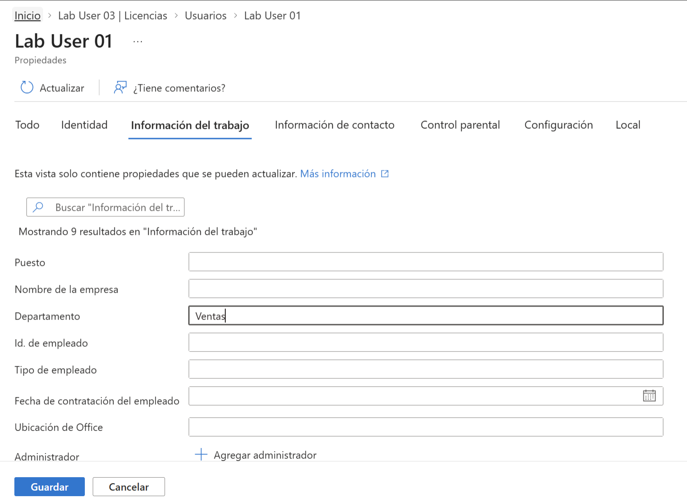
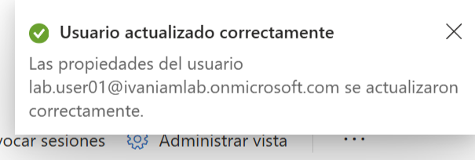
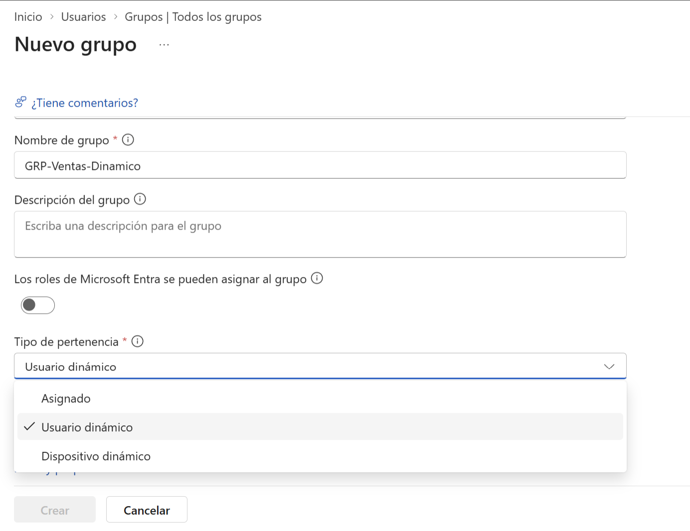
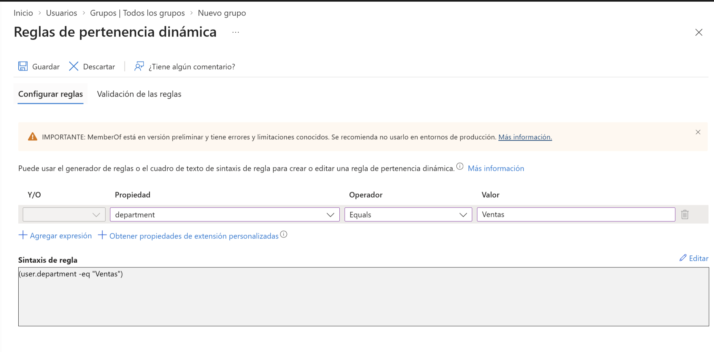
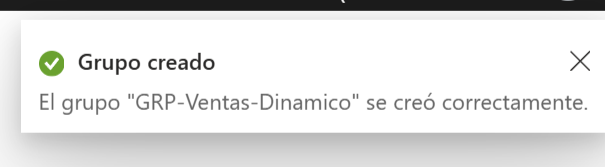
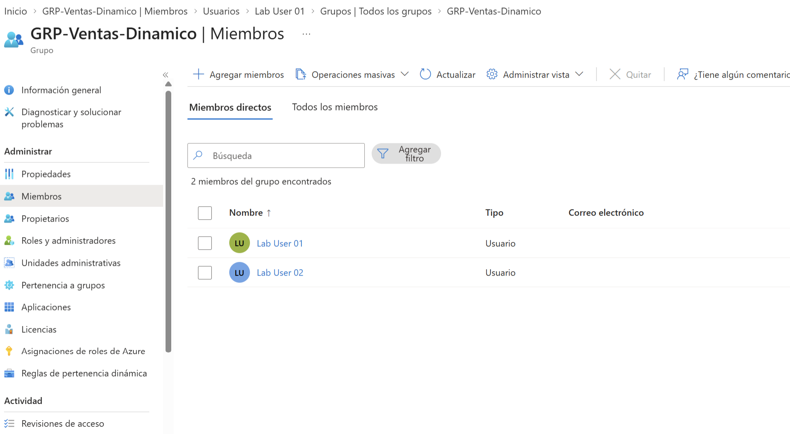
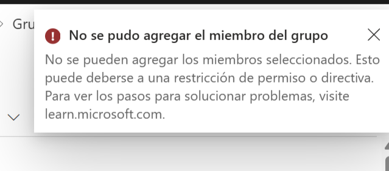
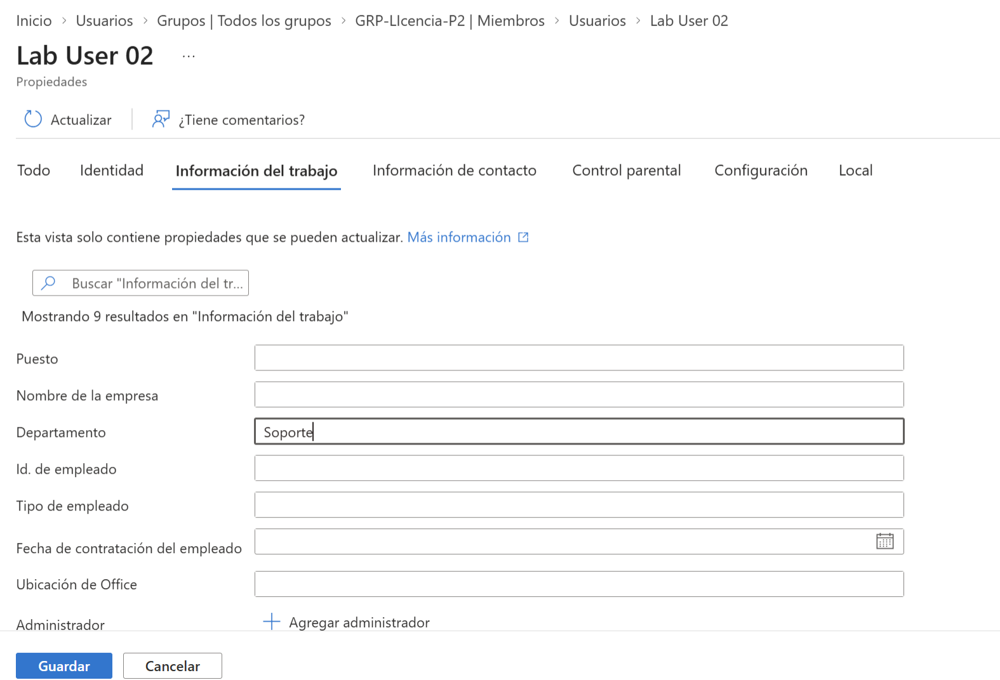
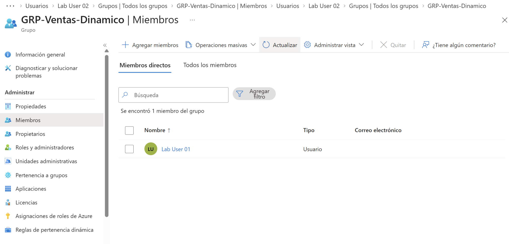

# Grupos dinámicos por departamento

- **Área del SC-300:** Implementar identidades en Microsoft Entra ID
- **Licencia necesaria:** Entra ID P1 o superior (en mi caso, la prueba de P2)

## Qué quería conseguir

Tener un grupo cuya pertenencia no gestiono yo a mano: una regla decide quién entra y quién sale según el departamento del usuario. Para comprobarlo, cambio el departamento de un usuario y veo cómo el grupo se actualiza solo.

## Requisitos previos

- Los tres usuarios de prueba del laboratorio anterior (`lab.user01`, `lab.user02` y `lab.user03`)
- Licencias de Entra ID P1 o superior en el tenant.

## Pasos

### 1. Poner un departamento a los usuarios

La regla del grupo va a mirar el atributo departamento, así que primero hay que rellenarlo. En Entra: Identidad → Usuarios → Todos los usuarios, abro el usuario → Propiedades → Información del trabajo → Editar, relleno el campo **Departamento** y guardo.

Al guardar aparece el aviso de que las propiedades del usuario se han actualizado.

El proceso es el mismo para los tres usuarios, así que solo hay captura de uno. A `lab.user01` y `lab.user02` les puse el departamento Ventas, y a `lab.user03` uno distinto, Soporte.

### 2. Crear el grupo dinámico

Identidad → Grupos → Todos los grupos → Nuevo grupo. Tipo de grupo Seguridad, nombre `GRP-Ventas-Dinamico` y tipo de pertenencia **Usuario dinámico**.

Al elegir ese tipo de pertenencia aparece el botón **Agregar consulta dinámica**, que abre el generador de reglas (no tengo captura del botón, solo de lo que abre). Ahí definí la regla: propiedad `department`, operador "Es igual a" y valor `Ventas`. Escrita en la sintaxis de Microsoft queda como `(user.department -eq "Ventas")`.

Guardé la regla y creé el grupo.

### 3. Comprobar los miembros

Abrí el grupo → Miembros. Los usuarios con departamento Ventas aparecieron muy rápido, en cuestión de segundos, sin que yo añadiera a nadie.

### 4. Intentar añadir un miembro a mano

Probé a añadir a `lab.user03`, que no cumple la regla, desde Miembros → Agregar miembros.

El panel de selección se abre con normalidad, pero al confirmar sale un error de que no se pudo agregar el miembro al grupo. En un grupo dinámico solo la regla decide quién entra.

### 5. Cambiar de departamento a un usuario

Cambié el departamento de `lab.user02` de Ventas a Soporte.

En pocos segundos salió del grupo, y solo quedó `lab.user01`.

Después volví a ponerle Ventas a `lab.user02` para que volviera a entrar, y esa vez tardó unos 4 minutos en aparecer dentro del grupo.

## Cómo comprobé que funciona

- Al crear el grupo se llenó solo con los usuarios de Ventas
- El intento de añadir a mano a un usuario que no cumplía la regla dio error
- Al cambiar el departamento de `lab.user02`, salió del grupo sin que yo hiciera nada más
- Al devolverle Ventas, volvió a entrar

## Qué me falló o me costó entender

Esta vez el procedimiento fue fluído y no se me atascó nada. Lo que me llamó la atención:

**Los tiempos no fueron iguales.** El grupo se llenó en segundos y `lab.user02` salió en segundos, pero cuando volví a ponerle Ventas tardó unos 4 minutos en entrar. No sé a qué se debe la diferencia, así que no doy por hecho que el procesamiento sea siempre inmediato.

**El error al añadir a mano no se ve hasta el final.** El panel para elegir usuarios se abre como en un grupo normal y el fallo aparece al confirmar. Es el comportamiento esperado, pero lo noté tarde.

## Qué haría distinto en un entorno real

- Me aseguraría de que el atributo del que depende la regla está bien escrito. Si el departamento está vacío o mal escrito, el usuario no entra en el grupo, y en una empresa real alguien tendría que cuidar ese dato.
- No contaría con que los cambios sean inmediatos. En un tenant pequeño como el mío tardaron segundos o pocos minutos, pero en uno grande puede ser distinto.
- Combinaría este grupo con la licencia por grupo del laboratorio anterior, para que un usuario reciba su licencia solo por estar en el departamento correcto.

## Enlaces

- [Crear o actualizar un grupo de pertenencia dinámica (Microsoft Learn)](https://learn.microsoft.com/en-us/entra/identity/users/groups-create-rule)
- [Añadir o quitar miembros de un grupo automáticamente (Microsoft Learn)](https://learn.microsoft.com/en-us/azure/active-directory/enterprise-users/groups-dynamic-tutorial)
