# Identidades externas (B2B): invitar a un usuario de fuera de la organización

- **Área del SC-300:** Implementar identidades en Microsoft Entra ID
- **Licencia necesaria:** Entra ID P1 o superior para el grupo dinámico (en mi caso, la prueba de P2)

## Qué quería conseguir

Invitar a una persona externa a mi tenant de laboratorio, ver cómo acepta la invitación, limitar a qué dominios se puede invitar, agrupar a los invitados de forma automática y, para terminar, retirar al invitado.

## Requisitos previos

- Una dirección de correo externa a mi tenant y a la que tengo acceso. Usé un Gmail de pruebas
- Una cuenta de administrador del tenant
- Para el grupo dinámico, licencias de Entra ID P1 o superior

## Pasos

### 1. Revisar la configuración de colaboración externa

Antes de invitar a nadie miré la configuración de colaboración externa (External Identities → Configuración de colaboración externa), que es donde se decide quién puede invitar y qué pueden ver los invitados.

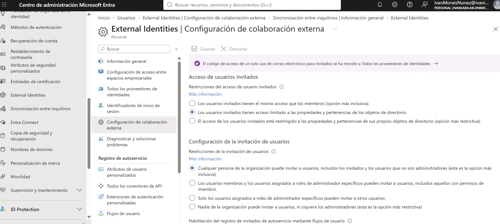

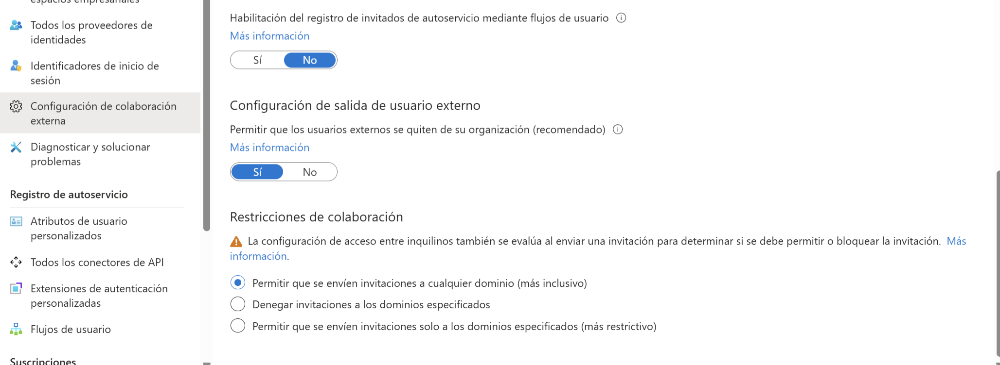

### 2. Invitar al usuario externo

Identidad → Usuarios → Todos los usuarios → Nuevo usuario → Invitar usuario externo.

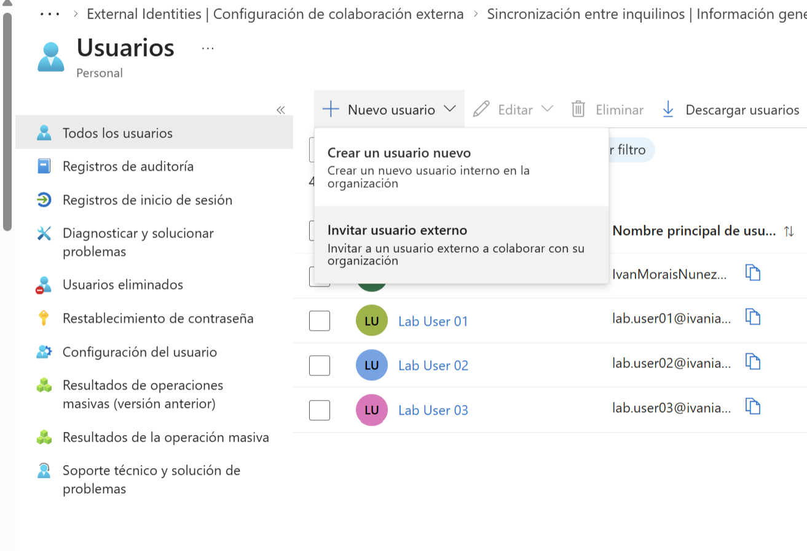

Rellené el correo del invitado, un nombre para mostrar (`Invitado Lab`) y un mensaje de bienvenida.

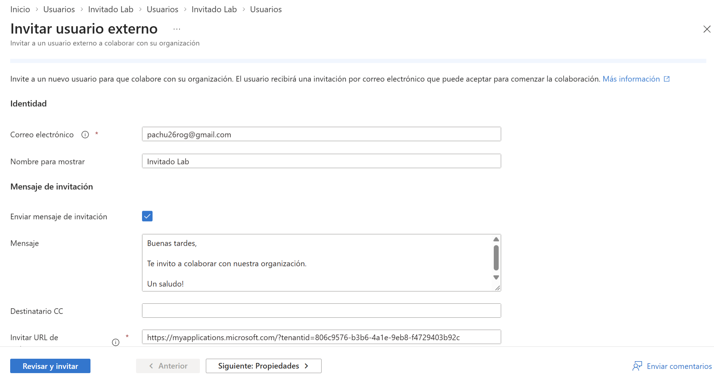

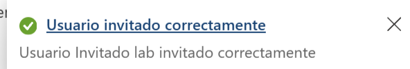

Mientras no acepte, el invitado ya aparece en el directorio con la invitación pendiente.

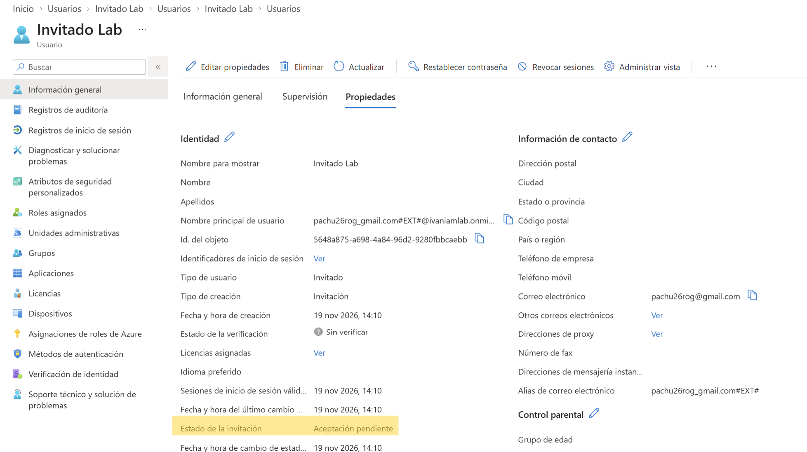

### 3. Aceptar la invitación

La invitación no llegó a la bandeja de entrada: estaba en la carpeta de spam.

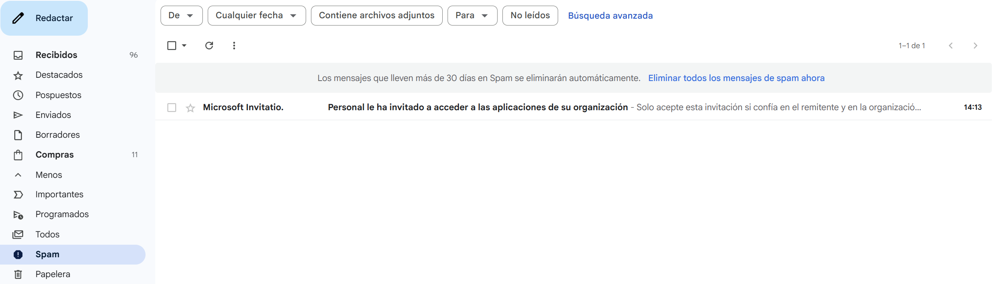

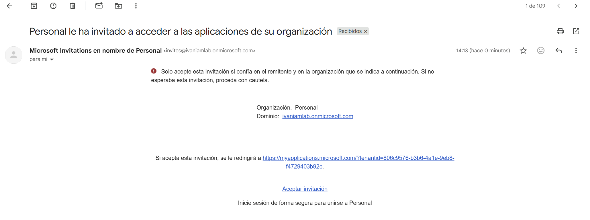

Al pulsar el enlace, Microsoft me pidió iniciar sesión con un código que me enviaron al propio correo del invitado.

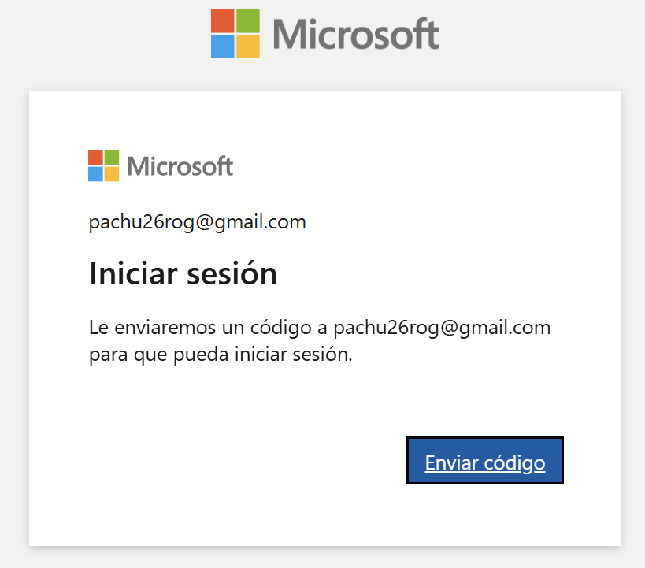

Después apareció la pantalla de permisos, donde la organización que invita pide ver el perfil básico del invitado.

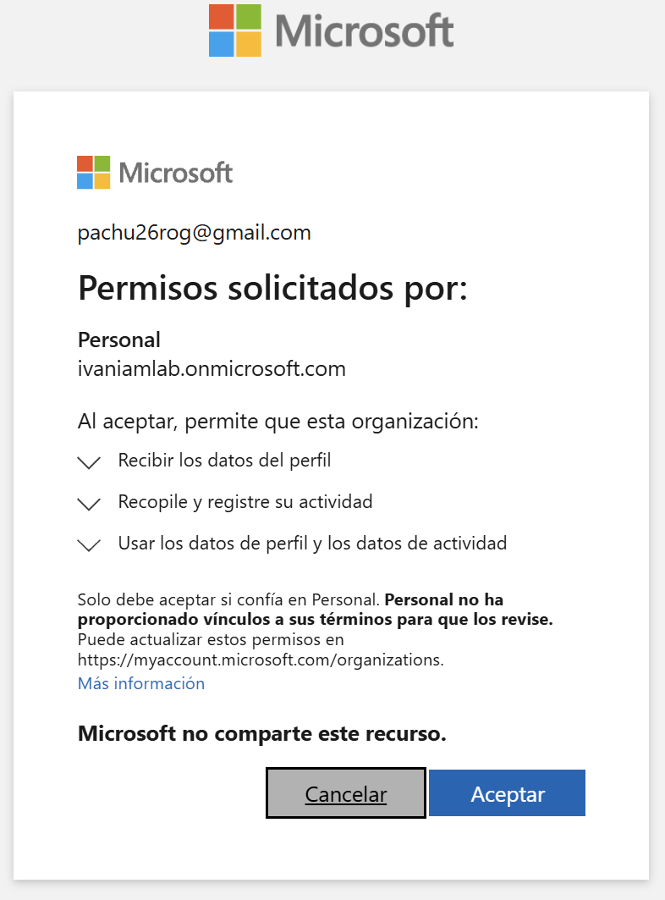

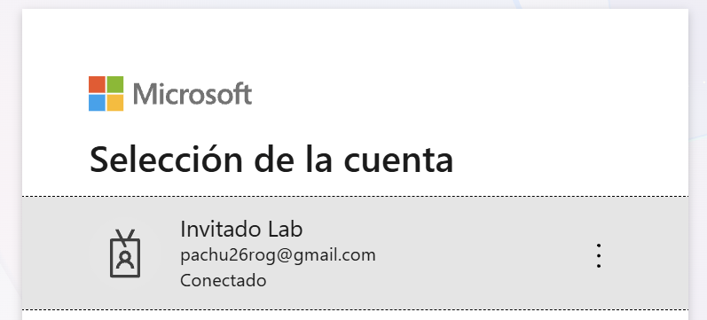

De vuelta en Entra, la ficha del invitado ya muestra la invitación como aceptada.

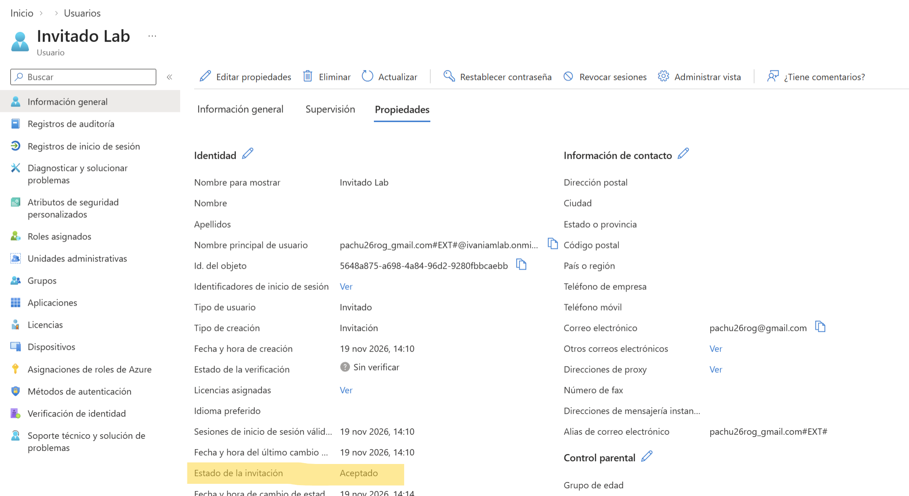

En la sección de identificadores de inicio de sesión de la ficha, el emisor del invitado aparece como `mail`, que corresponde al método del código por correo, y el tipo de inicio de sesión figura como `federated`. Hay además un identificador de tipo `userPrincipalName` con el dominio de mi tenant, que es el nombre de usuario con el que se creó la cuenta de invitado dentro del directorio.

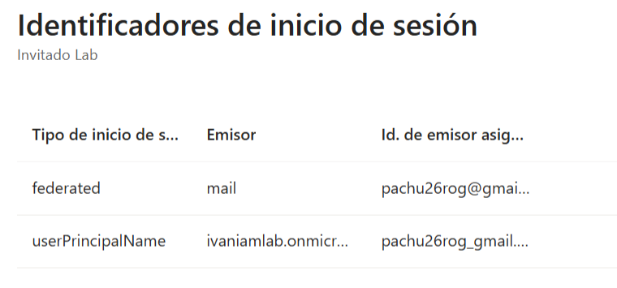

### 4. Limitar a qué dominios se puede invitar

En la configuración de colaboración externa, en las restricciones de colaboración, elegí denegar las invitaciones a un dominio de prueba.

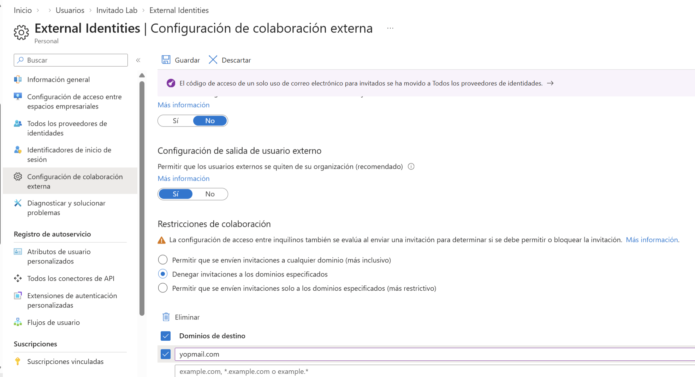

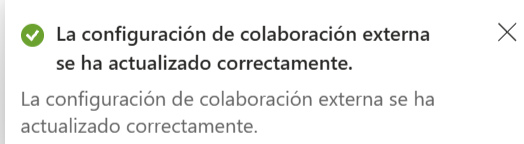

Después intenté invitar a una dirección de ese dominio.

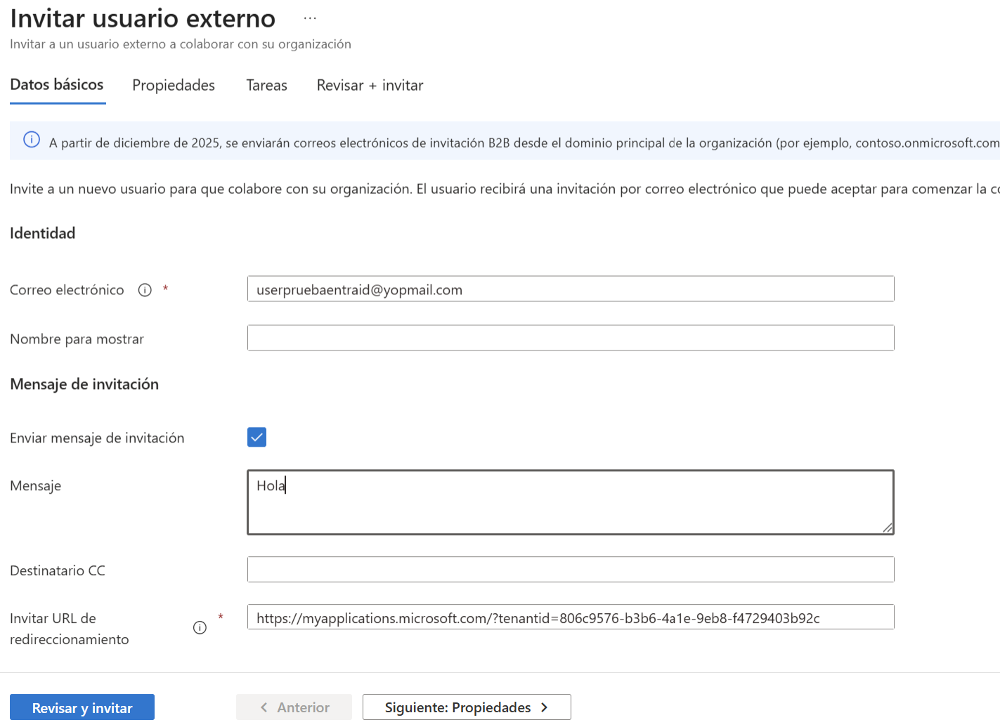

Entra rechazó la invitación con un error que dice que mi organización no permite la colaboración con el dominio del usuario invitado.

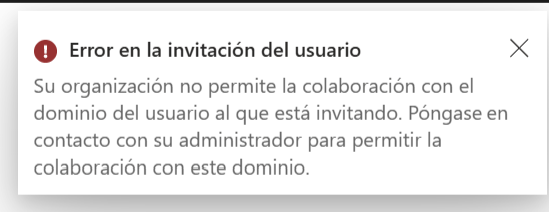

### 5. Un grupo dinámico solo para invitados

Creé un grupo de seguridad con pertenencia dinámica y añadí la regla `(user.userType -eq "Guest")`, que mete en el grupo a todos los usuarios de tipo invitado.

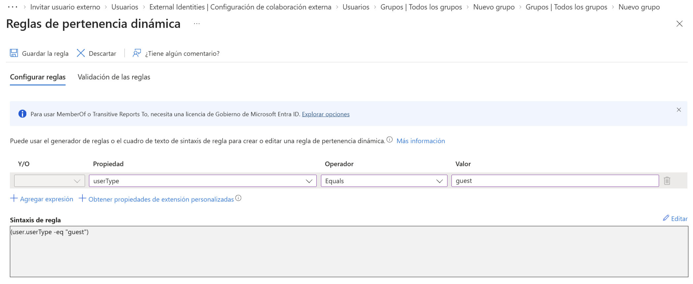

Al volver al formulario del grupo, este ya ofrece editar la regla dinámica, lo que indica que quedó añadida.

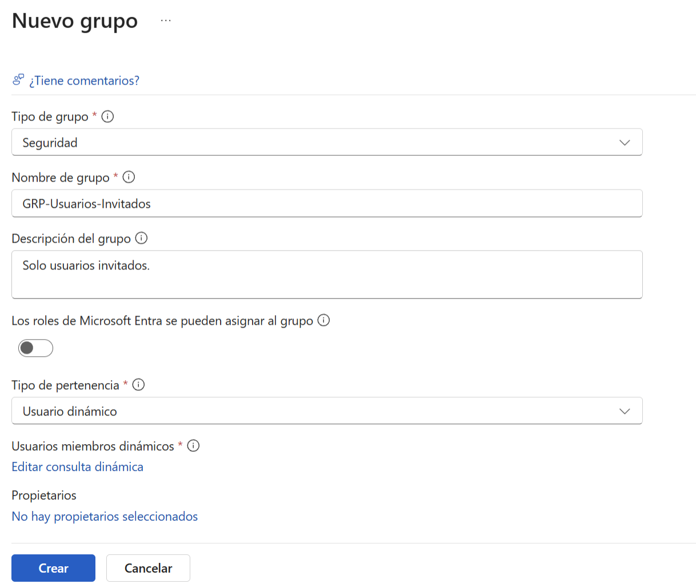

El invitado no apareció al instante: tardó aproximadamente un minuto en añadirse al grupo, aunque no había nada más que hacer por mi parte.

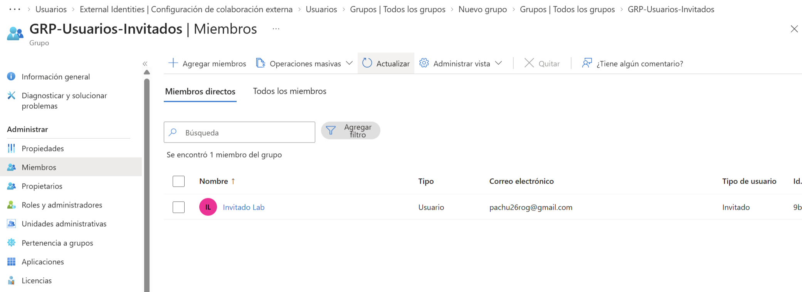

### 6. Eliminar al invitado

Para terminar, eliminé al invitado desde la lista de usuarios.

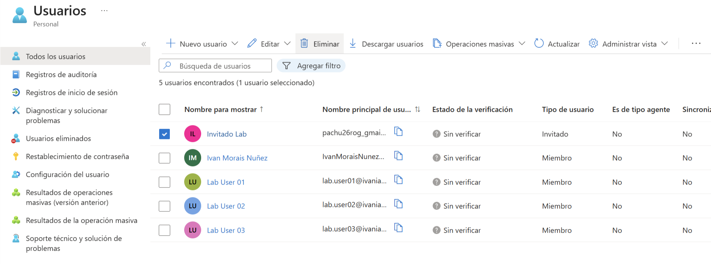

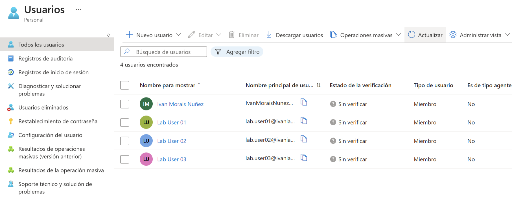

## Cómo comprobé que funciona

- Tras aceptar, la ficha del invitado mostraba la invitación como aceptada
- Con la restricción activa, Entra rechazó la invitación a una dirección del dominio bloqueado
- El invitado entró en el grupo dinámico sin que yo hiciera nada
- Al final, el invitado desapareció de la lista de usuarios

## Qué me falló o me costó entender

**Las invitaciones llegaron a la carpeta de spam.** Pensé que no habían llegado hasta que busqué ahí. Si una invitación no aparece, hay que revisar siempre el spam antes de volver a enviarla.

**El grupo dinámico no se llenó al instante.** El invitado tardó aproximadamente un minuto en aparecer en el grupo. No es mucho, pero no es inmediato, y no conviene dar por hecho que un cambio se refleja en el acto.

**Aceptar la invitación no influye para entrar en el grupo.** La pertenencia es totalmente independiente de que el invitado haya aceptado o no. La regla mira el tipo de usuario, y el invitado ya es de tipo invitado desde que se envía la invitación.

## Qué haría distinto en un entorno real

- Avisaría a la persona invitada de que el correo viene de Microsoft Invitations y de que puede acabar en spam, para que no crea que no ha llegado.
- Tendría presente que la pertenencia a un grupo dinámico de invitados no depende de que hayan aceptado la invitación, y lo tendría en cuenta antes de dar acceso a recursos a través de ese grupo.
- Si la organización solo colabora con ciertos dominios, configuraría las restricciones de colaboración desde el principio, antes de enviar invitaciones.

## Enlaces

- [Fundamentos de B2B en Microsoft Entra External ID (Microsoft Learn)](https://learn.microsoft.com/en-us/entra/external-id/b2b-fundamentals)
- [Administrar la colaboración externa (Microsoft Learn)](https://learn.microsoft.com/en-us/training/modules/implement-manage-external-identities/3-collaboration)
